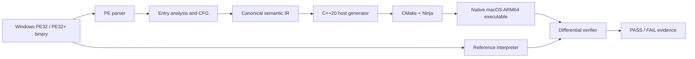

# Recomp Studio

Recomp Studio is an experimental, source-available static recompilation CLI for
legally obtained Windows executables. Its verified MVP accepts genuine PE32
(x86) and PE32+ (x64) machine code and produces a native macOS ARM64 host
program for a deliberately small, tested instruction subset.

The project is intentionally fail-closed: unsupported formats, instructions,
imports, and runtime behavior report errors rather than fabricated success.

## Status

| Capability | Status |
| --- | --- |
| PE32/x86 and PE32+/x64 structural inspection | Supported |
| Entry-reachable instruction analysis and canonical IR | Supported subset |
| macOS ARM64 generated-host build and execution | Supported subset |
| Differential reference-vs-native verification | Supported subset |
| Windows imports, memory, calls, branches, graphics, x87/SSE | Not implemented |
| Linux, WebAssembly, .NET, and full-game portability | Not implemented |

The working subset includes immediate register `mov`, `add`, `sub`, `nop`, and
`ret`. Other decoded instructions are not automatically safe to lower yet.

## Architecture



The parser and analyzer retain guest RVAs rather than treating guest addresses
as host pointers. The verifier independently evaluates the supported original
instruction stream before comparing it with the generated native executable.

## Quick start

Requirements: macOS on Apple Silicon, CMake 3.26+, Ninja, a C++20 compiler,
and Python 3. The test fixtures are generated locally and do not contain game
assets.

```sh
git clone https://github.com/heaven-hm/recomp-studio.git
cd recomp-studio
./scripts/test.sh
```

## Analysis toolchain

The core demo builds with CMake, Ninja, C++20, and Python 3. The following
open-source tools support deeper intake, disassembly, lifting, emulation, and
verification work:

| Tool | Purpose | Install |
| --- | --- | --- |
| LIEF | PE/ELF/Mach-O parsing | `brew install lief` |
| Capstone | Instruction decoding | `python3 -m pip install --user capstone` |
| Zydis | Independent x86 decoder | `brew install zydis` |
| Ghidra | Optional CFG/function recovery | `brew install ghidra` |
| Radare2 | Optional analysis cross-check | `brew install radare2` |
| Unicorn | Reference CPU emulation | `python3 -m pip install --user unicorn` |
| angr | Symbolic analysis/lifting | `python3 -m pip install --user angr` |
| Z3 | Constraint/equivalence checks | `brew install z3 && python3 -m pip install --user z3-solver` |
| Frida | Optional runtime instrumentation | `python3 -m pip install --user frida-tools` |

Verify the current installation with:

```sh
ghidraRun --help
r2 -v
z3 --version
frida --version
python3 -c 'import angr, unicorn, capstone, z3; print(angr.__version__)'
```

Use a Python virtual environment for analysis packages on shared development
machines, because `angr` can require versions that conflict with unrelated
Python applications.

Binary Ninja and IDA are proprietary. Recomp Studio does not download them;
install either manually under its applicable license, then configure it as an
optional analysis adapter. Binary Ninja is detected locally at
`/Applications/Binary Ninja.app` but is not a build requirement.

### Automated bootstrap

Use the portable bootstrapper to inspect or install the free toolchain:

```sh
./scripts/bootstrap.sh            # dry-run: show exactly what will happen
./scripts/bootstrap.sh --install  # install free dependencies and isolated Python tools
```

It supports macOS/Homebrew and Linux systems using APT, DNF, or Pacman. Python
analysis packages are installed under `.tools/python` by default, never into a
shared Python environment. Set `RECOMP_STUDIO_PREFIX` to relocate that folder.

## CLI workflow

```sh
# Build the CLI
./scripts/build.sh

# Inspect, analyze, and lift a user-supplied PE executable
build/recomp-studio inspect game.exe --json
build/recomp-studio analyze game.exe --json
build/recomp-studio lift game.exe --json

# Generate, build, run, and verify a supported macOS ARM64 project
build/recomp-studio translate game.exe --target macos-arm64 --output out/game
build/recomp-studio build out/game
build/recomp-studio run out/game
build/recomp-studio verify out/game --json

# See demonstrator and public-profile status
build/recomp-studio examples list
```

JSON output is clean for automation; normal output includes compact progress
logs (`loading`, `working`, `idle`, and `complete`).

## Legal and security

Recomp Studio is distributed under the **Heaven-HM Community Modding License
— Version 1.0**, a custom source-available, noncommercial license. It permits
lawful study, modification, and free sharing with attribution and the same
terms. It prohibits unlawful activity, unauthorized access, malware, and
distribution of unlawfully obtained material.

Use only executables and assets you are authorized to analyze. Recomp Studio
does not include commercial game files and makes no claim of compatibility with
any game or application beyond the documented, verified subset. Do not run
untrusted generated projects. See [SECURITY.md](SECURITY.md) for reporting
security issues and [LICENSE](LICENSE) for the complete binding terms.

## Contributing

Contributions are welcome. Please read [CONTRIBUTING.md](CONTRIBUTING.md), run
`./scripts/test.sh` before submitting changes, and keep unsupported behavior
explicit. Release history is maintained in [CHANGELOG.md](CHANGELOG.md).
