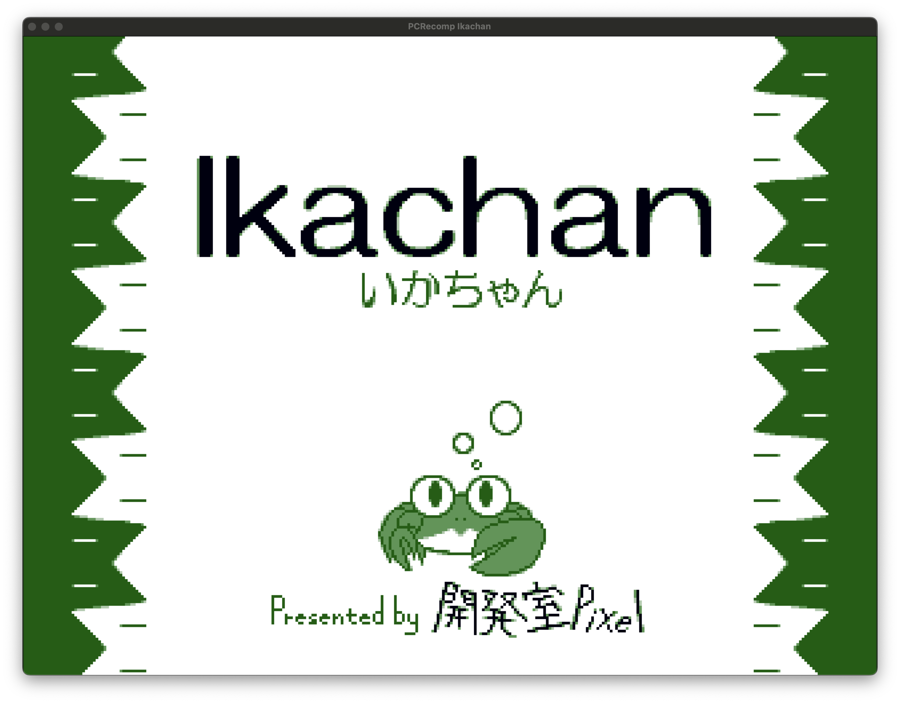

# Decomp Studio

**Recover, recompile, and verify software for the future.**

Decomp Studio (formerly Recomp Studio; earlier roadmap name Recomp-Agent) is a general-purpose hybrid decompilation
and static recompilation project, with an initial focus on preserving 2D and 3D
games. It combines machine-level translation with external analysis providers
and aims to produce source and native executables whose behavior can be tested
against the original.

## Direction and current status

Our target is Windows, macOS, and Linux software across x86, x86-64, ARM32,
and ARM64, both as input architectures and native targets. These are **project
goals, not a support guarantee**. Initial work concentrates on Windows x86 and
x86-64 PE executables and macOS ARM64 output. Other formats, architectures,
runtimes, graphics, audio, and input require further implementation and testing.

The existing pipeline can inspect PE files, recover candidate functions, lift a
subset of x86 instructions, emit low-level C++, compile it, and compare selected
behavior using Unicorn. A bounded readable-source path recognizes exact
constant-return leaf functions when requested with `translate --source-style
readable`; every function outside that proven pattern remains explicit
machine-level fallback code. Ghidra analysis and rev.ng artifacts have
external-tool adapters. The PCRecomp runtime has experimental integration
tests. This is not yet broad type recovery or a complete high-level
reconstruction pipeline.

A [15-game test](reports/real-games-2026-10-29.md) produced **zero verified
playable games**. An independent Windows oracle, a complete GUI/game runtime,
and verified gameplay scenarios remain open work. Instruction coverage and a
successful build do not establish behavioral equivalence.

<p align="center"></p>

*Experimental PCRecomp host rendering Ikachan's title screen using the user's
original game files and a scripted Enter key. This is not the standard
`autorecomp` pipeline, a verified gameplay scenario, or a released port.*

## How it compares

These tools overlap and can complement one another; this table compares their
published focus with Decomp Studio's **planned** workflow, not their maturity.

| Project | Published focus | Decomp Studio's direction |
| --- | --- | --- |
| [rev.ng](https://rev.ng/) | Binary analysis and high-level decompilation across several architectures. | Combine its analysis artifacts with other providers, low-level recompilation and game-runtime verification. The adapter is experimental. |
| [decompdecomp](https://github.com/n-delic/decompdecomp) | AI-assisted game decompilation targeting matching, byte-for-byte rebuilds. | Aim for observable behavioral equivalence and native outputs; AI is optional and exact original machine-code matching is not the goal. |
| [Ghidra](https://github.com/NationalSecurityAgency/ghidra) | General reverse engineering, disassembly and decompilation framework. | Use Ghidra as an analysis provider within a larger intended source-to-native-build workflow. |
| [PCRecomp](https://github.com/sp00nznet/pcrecomp) | Static recompilation tools and runtime infrastructure for PC software. | Reuse compatible pieces alongside semantic analysis and verification; the runtime bridge is experimental. |
| [N64Recomp](https://github.com/N64Recomp/N64Recomp) | Static recompilation of Nintendo 64 game code. | Target general software formats and host architectures, initially legacy Windows games; those broader targets are not yet implemented. |

## Third-party foundations

| Component | License | Current relationship |
| --- | --- | --- |
| [PCRecomp](https://github.com/sp00nznet/pcrecomp) | MIT | External tools and optional runtime tests; adapted GDI source. |
| [Ghidra](https://github.com/NationalSecurityAgency/ghidra) | Apache-2.0 | Optional external analysis and decompiler adapter. |
| [rev.ng](https://github.com/revng/revng) | GPL-2.0 | External-process adapter tested with a stand-in; real provider not verified here. |
| [Remill](https://github.com/lifting-bits/remill) | Apache-2.0 | Selected instruction semantics adapted with attribution. |
| [LLVM / Clang](https://github.com/llvm/llvm-project) | Apache-2.0 with LLVM exception | Compiler for generated C++. |
| [Unicorn](https://github.com/unicorn-engine/unicorn) | GPL-2.0 | Optional reference CPU emulation; shared shims limit independence. |
| [Capstone](https://github.com/capstone-engine/capstone) | BSD-3-Clause | Instruction decoding. |
| [igi-recomp](https://github.com/HenryKun55/igi-recomp) and [project-igi-browser](https://github.com/Dhaiwat10/project-igi-browser) | MIT | Selected attributed runtime adaptations. |
| [SDL](https://github.com/libsdl-org/SDL) | zlib | Optional PCRecomp runtime dependency; indexed-bitmap technique adapted. |
| [hisahi/scanf](https://github.com/hisahi/scanf), [nlohmann/json](https://github.com/nlohmann/json) | MIT | Vendored scanner and JSON parser. |
| [CMake](https://cmake.org/), [Ninja](https://github.com/ninja-build/ninja) | BSD-3-Clause, Apache-2.0 | Build tools. |
| [mingw-w64](https://github.com/mingw-w64/mingw-w64) | Mixed; see notices | Optional Windows fixture compiler and headers. |

LIEF, Zydis, angr, Z3, radare2, Frida, Wine, Anvill and Rellic are optional
research or future integrations, not a claim they are installed or used by the
current pipeline. See [upstream components](docs/UPSTREAM_COMPONENTS.md),
[tools.lock.json](tools.lock.json), and [third-party notices](THIRD_PARTY_NOTICES.md)
for file-level provenance, exact versions, and distribution obligations.

## Build and try

Install a C++20 toolchain, CMake, Ninja, and the dependencies listed in `CMakeLists.txt`, then:

```sh
./scripts/build.sh
build/recomp-studio doctor
build/recomp-studio autorecomp /path/to/game.exe --output /tmp/recomp-game --buildrun --timeout 5
```

The executable is currently named `recomp-studio`; the project name change does not
rename the CLI yet. Use a legally obtained executable and assets. Generated output is experimental;
a built executable is not necessarily functional. Run `build/recomp-studio --help`
for commands and `ctest --test-dir build --output-on-failure` for tests.

## How it fits together

1. **Inspect and analyze:** parse the binary and recover candidate functions;
   use Ghidra and other providers for additional evidence.
2. **Reconstruct and recompile:** retain low-level translated code where
   high-level reconstruction is not verified, and compile the delivered source.
3. **Provide compatibility:** reuse appropriately licensed runtime components
   for OS and game APIs, reporting missing behavior explicitly.
4. **Verify:** compare execution and observable behavior, recording the oracle,
   coverage, limitations, and evidence for each scenario.

Verification currently shares some runtime shims between the candidate and its
Unicorn reference, so agreement can miss errors common to both. Independent
execution of the original on Windows remains a priority.

## Project documentation

- [Architecture](docs/ARCHITECTURE.md) and [implementation plan](docs/IMPLEMENTATION_PLAN.md)
- [Semantic bridge](docs/SEMANTIC_BRIDGE.md), [ABI and types](docs/ABI_AND_TYPES.md), and [verification](docs/VERIFICATION.md)
- [Upstream components](docs/UPSTREAM_COMPONENTS.md) and [third-party notices](THIRD_PARTY_NOTICES.md)
- [Game test results](reports/real-games-2026-10-29.md) and [historical application results](reports/apps-running-results.md)

Game binaries and assets are not distributed with this project. See [LICENSE](LICENSE)
and the third-party notices for source licensing and attribution.
