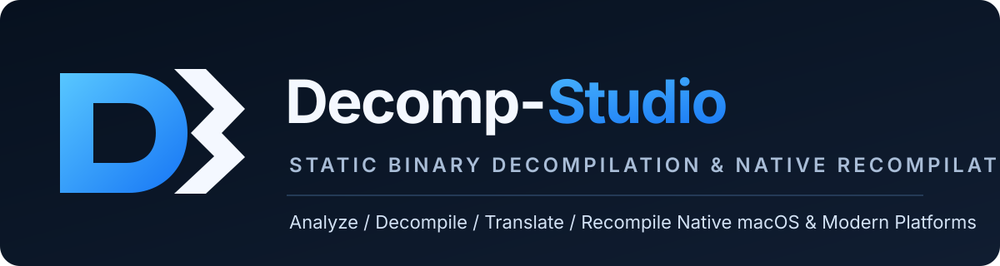
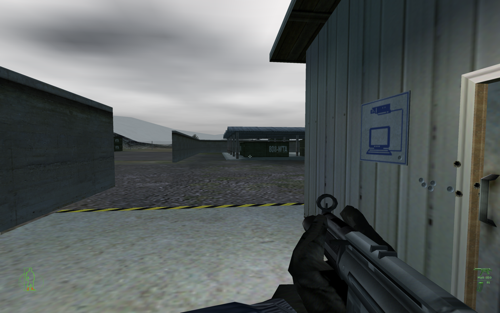
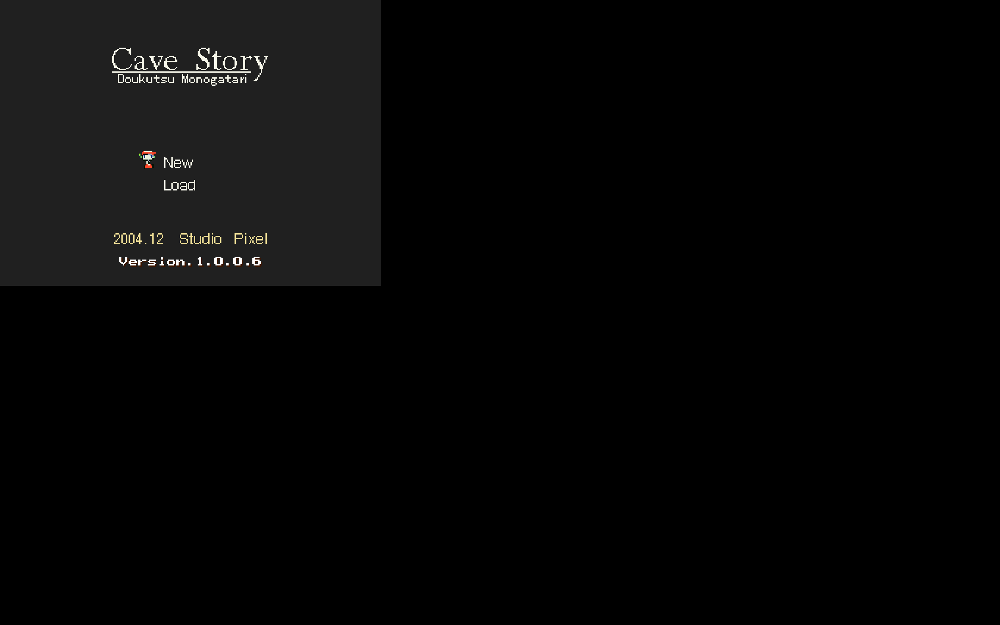
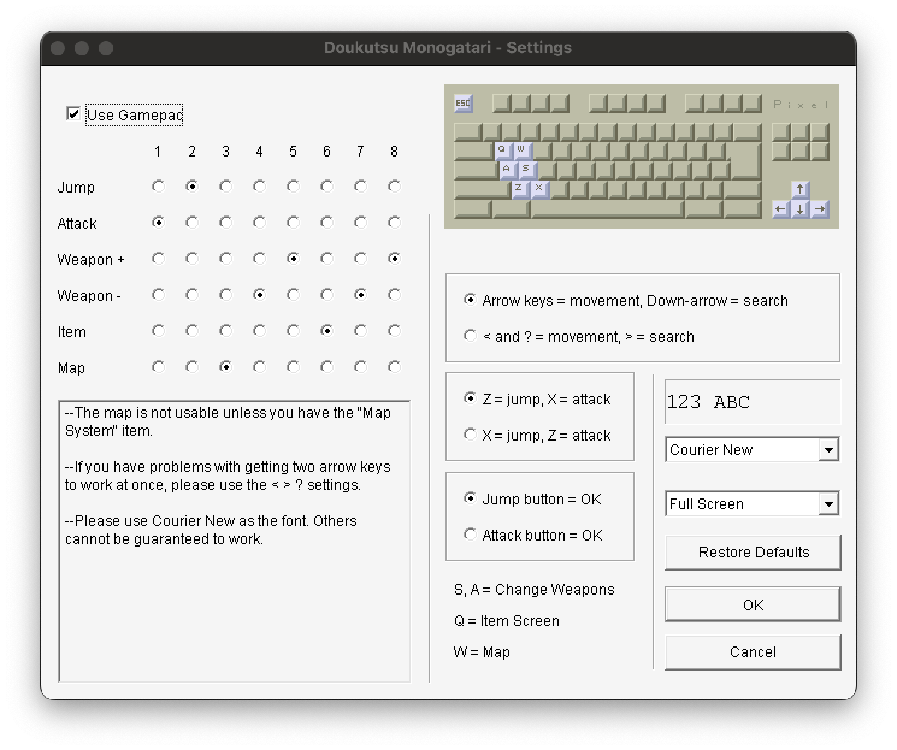
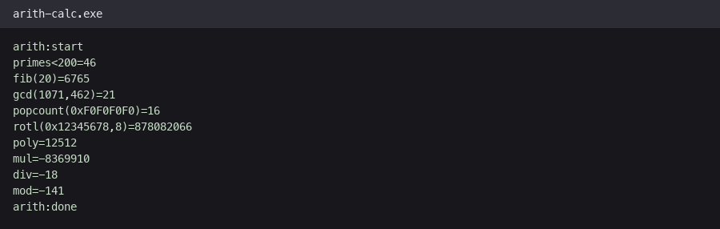
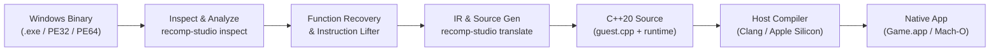

# Decomp-Studio

<p align="center">
  
</p>

<p align="center">
  <strong>Analyze. Decompile. Recompile. Run legacy games and binaries natively on modern operating systems.</strong>
</p>

---

## Overview

**Decomp-Studio** is an automated static binary decompilation and native recompilation toolkit designed to lift legacy x86/x64 Windows executables (PE32/PE32+) into portable C++20 and compile them directly into native Apple Silicon (macOS ARM64) and modern platform binaries.

Instead of running slow CPU emulation or heavy virtualization layers, Decomp-Studio analyzes binary structure, recovers functions, lifts machine instructions into a structured intermediate representation (IR), and emits native source code with an integrated Win32 High-Level Emulation (HLE) runtime.

---

## Native Execution Showcase

Decomp-Studio translates legacy binaries into native Mach-O ARM64 executables and bundles them into signed macOS `.app` packages:

<p align="center">
  
  <br>
  <em>Native Apple Silicon ARM64 Mach-O execution of Tetris recompiled from Windows x86 PE32.</em>
</p>

<table align="center">
  <tr>
    <td align="center">
      <br>
      <b>Cave Story Native Runtime</b>
    </td>
    <td align="center">
      <br>
      <b>Cave Story Configurator (DoConfig)</b>
    </td>
  </tr>
  <tr>
    <td align="center">
      <br>
      <b>Ikachan Title Screen</b>
    </td>
    <td align="center">
      <br>
      <b>Deterministic Verification Harness</b>
    </td>
  </tr>
</table>

---

## Core Capabilities

- **Automated Static Lifter**: Disassembles and decodes x86 and x64 instructions into typed semantic IR statements, tracking guest CPU register states and flags.
- **Hybrid Source Reconstruction**:
  - Automatically identifies, extracts, and emits verified high-level structured C++ for leaf functions, return accessors, and arithmetic blocks.
  - Falls back deterministically to low-level machine semantic translation for complex routines, ensuring zero-gap instruction coverage.
- **Portable 64x64 to 128-bit Arithmetic**: Built-in multi-word arithmetic engine supporting `multiply_wide`, `divide_wide`, and `divide_wide_signed` across both 32-bit and 64-bit platforms without compiler-dependent `__int128` requirements.
- **Win32 Runtime Shim Layer**: Comprehensive host shimming for Kernel32, CRT (stdio, time, heap, strings), User32, and GDI32.
- **macOS App Bundler (`build-macos-app.sh`)**: One-click script to translate any Windows PE executable, compile native ARM64 Mach-O with Clang, generate `Info.plist`, ad-hoc codesign, and package into a standalone macOS `.app`.
- **Differential Verification**: Built-in test harness verifying translated execution against golden baselines and memory safety invariants.

---

## End-to-End Recompilation Pipeline



1. **Inspect & Detect:** Validate PE headers, machine architecture, imports, and subsystem.
2. **Recover & Lift:** Identify function boundaries, build control flow graphs (CFG), and lift machine code into intermediate statements.
3. **Translate:** Generate C++20 source code (`guest.cpp`) and link against `recomp_runtime.cpp`.
4. **Compile:** Compile with `clang++ -std=c++20 -O1 -target arm64-apple-macos11`.
5. **Package & Run:** Assemble into a signed macOS application bundle (`Game.app`).

---

## Quick Start

### 1. Build the Decomp-Studio Toolchain

Prerequisites: CMake 3.20+, Ninja, and a C++20 compiler (AppleClang 15+ or GCC/Clang 13+):

```sh
# Clone and build
./scripts/build.sh

# Verify build health
build/recomp-studio doctor
```

### 2. One-Command Recompile to macOS `.app`

To recompile any Windows executable into a native Apple Silicon `.app`:

```sh
./scripts/build-macos-app.sh /path/to/game.exe out/mygame --run
```

This automates translation, compilation with Clang, packaging into `out/mygame/Game.app`, codesigning, and launching.

### 3. Step-by-Step CLI Usage

```sh
# Check binary coverage and missing imports
build/recomp-studio coverage /path/to/game.exe
build/recomp-studio imports /path/to/game.exe

# Translate to C++ source
build/recomp-studio translate /path/to/game.exe --output out/game

# Build generated project
build/recomp-studio build out/game

# Run generated native binary
build/recomp-studio run out/game
```

---

## Comparison & Design Inspiration

| Project | Focus | Decomp-Studio Synergy |
| :--- | :--- | :--- |
| **PCRecomp** | Static recompilation runtime for PC software | Reuses compatible recompilation paradigms and runtime techniques for game-focused pipelines. |
| **rev.ng** | Multi-architecture binary analysis and decompilation | Analysis artifacts inform function recovery and control-flow reconstruction. |
| **Ghidra** | Interactive reverse-engineering framework | External analysis provider adapter for cross-checking symbol and type recovery. |
| **N64Recomp** | Static recompilation for Nintendo 64 | Inspires static offline recompilation workflows adapted for legacy PC executables. |

---

## Repository Documentation

- [Architecture Guide](docs/ARCHITECTURE.md)
- [Implementation Plan](docs/IMPLEMENTATION_PLAN.md)
- [Semantic Bridge & IR Spec](docs/SEMANTIC_BRIDGE.md)
- [ABI and Types Specification](docs/ABI_AND_TYPES.md)
- [Verification & Differential Testing](docs/VERIFICATION.md)
- [Third-Party Notices & Licenses](THIRD_PARTY_NOTICES.md)

---

## License

This project is licensed under the terms described in [LICENSE](LICENSE). All game binaries, assets, and trademarks belong to their respective copyright holders and are not distributed with this repository.
