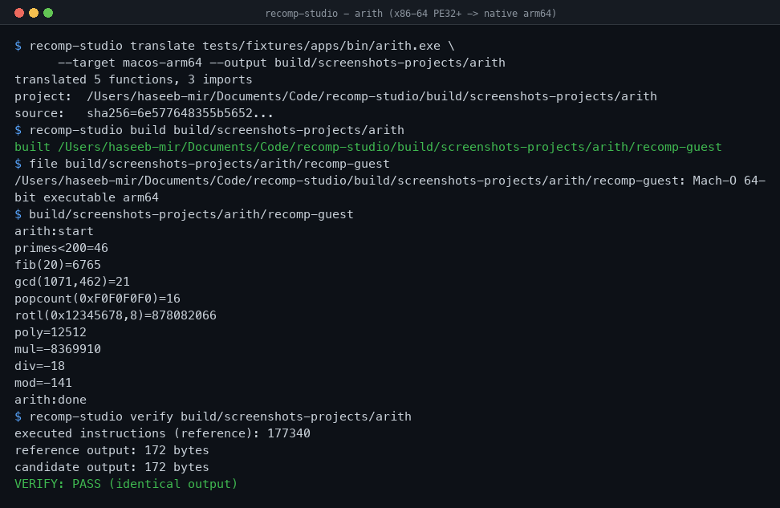
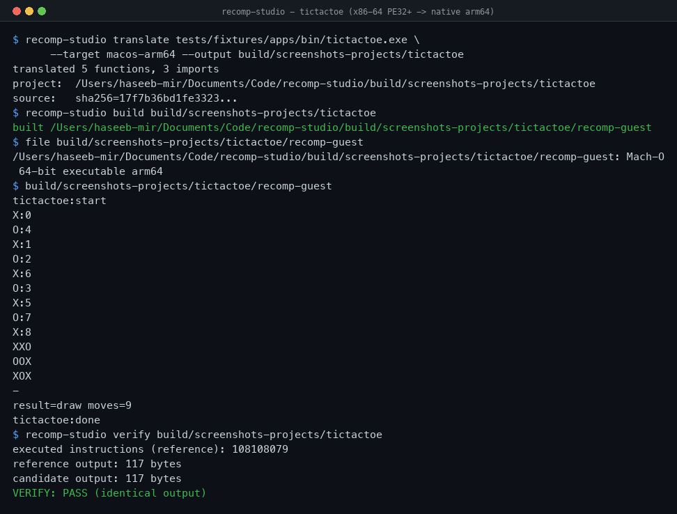
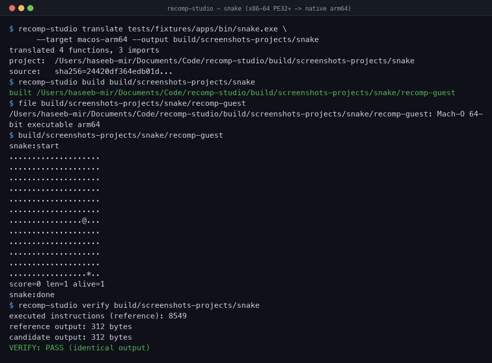

<p align="center">
  
</p>

# Recomp Studio

Recomp Studio is a static recompilation studio. It reads a guest executable,
recovers its functions, translates the original machine code into
architecture-neutral C++, and compiles that C++ into a native program for a
chosen host target. The translated program keeps the guest's own CPU state,
address space and operating-system shims, so it runs as an ordinary native
process with no emulator in the loop.

This is not a wrapper around an interpreter. Real x86-64 instructions are
decoded, lifted and re-emitted; the resulting binary is a genuine native
executable that is then checked, instruction by instruction, against the
original code.

Two guest architectures are supported: **Windows x86-64 (PE32+)** and
**Windows x86 (PE32)**, both → **native macOS ARM64**. The translation core is
shared; only the decoder mode, the guest pointer width and the emulated
calling convention differ. Linux x86-64/ARM64 and wasm32 are wired through the
target table.

## Proof

Eleven real Windows programs (nine PE32+ and two PE32) are compiled with
mingw-w64, recompiled to native ARM64, executed, and verified against the
original x86-64 / x86-32 code running under Unicorn. The output is
byte-identical. The set covers register aliasing, EFLAGS, calling conventions
(cdecl/stdcall/fastcall/thiscall), indirect dispatch, memory addressing and
64-bit arithmetic.







`tictactoe` plays a full nine-move minimax game and ends in a draw; the reference
execution runs 108,108,079 x86-64 instructions and the native ARM64 candidate
produces exactly the same 117 bytes of output.

## Status

| Capability | Status |
| --- | --- |
| PE32/PE32+ parsing (sections, imports, exports, relocations, TLS) | Implemented |
| Recursive-descent function recovery and CFG | Implemented |
| x86-64 (PE32+) → C++ lifter with exact EFLAGS semantics | Implemented, verified |
| x86 (PE32) → C++ lifter, 32-bit address wrapping | Implemented, verified |
| 32-bit calling conventions for imports (stdcall stack cleanup) | Implemented, verified |
| Native macOS ARM64 code generation and execution | Implemented, verified |
| Guest runtime: memory, CPU context, dispatch, import thunks | Implemented |
| Win32 compatibility shims (kernel32 subset) | Implemented subset |
| Differential verification (program output + instruction trace) | Implemented |
| Autonomous translate/build/verify/repair harness | Implemented |
| Config-driven stubs, native overrides, instruction patches | Implemented |
| Linux / WebAssembly targets | Targets wired, platform runtimes pending |
| x87, graphics (ddraw/d3d), DirectInput/DirectSound, .NET | Not implemented |
| Full commercial-game portability | Not claimed |

Anything not supported fails closed: unsupported instructions, unresolved
indirect targets and unimplemented imports report an explicit diagnostic instead
of pretending to work.

## Quick start

Requirements: macOS on Apple Silicon, a C++20 compiler, CMake 3.26+, Ninja, and
[Capstone](https://github.com/capstone-engine/capstone). Unicorn
(`brew install unicorn`) enables the verification backend. `mingw-w64` builds the
fixture executables (`brew install mingw-w64`).

```sh
git clone https://github.com/heaven-hm/recomp-studio.git
cd recomp-studio
./scripts/test.sh                     # configure, build, and run the regression suite
```

Recompile and verify the bundled fixtures by hand:

```sh
# 64-bit guest (PE32+)
./build/recomp-studio translate tests/fixtures/apps/bin/tictactoe.exe \
    --target macos-arm64 --output out/tictactoe
./build/recomp-studio build out/tictactoe
./build/recomp-studio run   out/tictactoe
./build/recomp-studio verify out/tictactoe      # PASS: byte-identical to the x86-64 reference

# 32-bit guest (PE32) — exercising cdecl/stdcall/fastcall/thiscall
./build/recomp-studio translate tests/fixtures/apps/bin/pe32_abi.exe \
    --target macos-arm64 --output out/pe32abi
./build/recomp-studio build out/pe32abi && ./build/recomp-studio verify out/pe32abi
```

## CLI

Full documentation, with a worked example for every command and every supported
operating system and processor, is in [MANUAL.md](MANUAL.md).

```
recomp-studio doctor                              Host and toolchain capability
recomp-studio inspect   <image>                   PE structure, imports, hashes
recomp-studio analyze   <image>                   Functions and instruction counts
recomp-studio functions <image>                   Recovered function candidates
recomp-studio cfg       <image> --address <hex>   Function CFG as Graphviz DOT
recomp-studio translate <image> --output <dir>    Recompile to a host project
recomp-studio build     <project>                 Build the generated project
recomp-studio run       <project>                 Run the generated project
recomp-studio verify    <project>                 Differential verification against the reference
recomp-studio repair    <image> --output <dir>    Autonomous translate/build/verify/diagnose/repair loop
recomp-studio report    <project>                 Generated project manifest
recomp-studio examples  list                      Bundled example profiles
```

Every command accepts `--json` for automation. `translate`, `build` and `repair`
accept `--config <file>`.

## Configuration

A project is described by a small configuration file; see
[`tests/fixtures/apps/recomp.toml`](tests/fixtures/apps/recomp.toml). Beyond the
basics (target, entry point, stack/heap placement, compiler, flags) it exposes
the advanced controls that mature recompilers rely on:

```toml
stub_function     = [0x140001000]              # replace with a returning no-op
native_override   = ["0x140001530: my_impl"]   # HLE: hand-written host function
instruction_patch = ["0x140001001: b9 f4 ff ff ff"]
extra_sources     = ["src/my_impl.cpp"]
```

## Verification and the repair harness

Verification is first-class and runs the original x86-64 code under Unicorn with
the same shim semantics as the runtime:

- **Program level** — bytes written to standard output must match exactly.
- **Trace level** — the executed guest address sequence must match; the first
  divergence identifies the responsible instruction.

The repair harness automates the loop: translate, build, verify, localise the
first divergence to an instruction, write a structured report per iteration, and
— when given an external agent command — hand the diagnosis over, rebuild and
retry. It never marks a translation verified merely because it compiled.

## Architecture

See [MANUAL.md](MANUAL.md) for the complete command reference and platform
support table, and [ARCHITECTURE.md](ARCHITECTURE.md) for the layer map, the
guest execution model, extension points, and the advanced roadmap (flag liveness, jump-table
recovery, x87/SSE, hash-guarded native replacement, relocatable overlays, an
interpreter fallback, and more targets).

## Instruction coverage

Integer and control flow: `mov`/`movabs`, `movzx`/`movsx`/`movsxd`, `lea`,
`xchg`, `push`/`pop`, `leave`, `add`/`sub`/`adc`/`sbb`, `and`/`or`/`xor`/`not`,
`inc`/`dec`/`neg`, `cmp`/`test`, `shl`/`shr`/`sar`/`rol`/`ror`/`rcl`/`rcr`,
`imul`/`mul`/`div`/`idiv`, `cdq`/`cqo`/`cwde`/`cdqe`, `setcc`, `cmovcc`,
`bt`/`bts`/`btr`/`btc`, `bsr`/`bsf`, `shld`/`shrd`, `xadd`/`cmpxchg`, `cpuid`,
`lahf`/`sahf`, `call`/`ret`/`jmp`/`jcc`, string ops with `rep`.

SSE/AVX subset: `movaps`/`movups`/`movapd`/`movupd`/`movdqa`/`movdqu`/`movss`/
`movsd`/`movd`/`movq`, scalar float and double arithmetic, vector bitwise and
integer add/sub/compare, `pshufd`, `punpck*`, `vpxor`/`vandps`/`vpor`,
`cvtdq2ps` (packed dword → float, honouring the MXCSR rounding mode),
`cvtsi2sd`/`cvttsd2si`/`cvtsd2ss`/`cvtss2sd`, `ldmxcsr`/`stmxcsr` (MXCSR is
modelled as guest state), prefetch hints. `lock` and `rep` prefixes are handled.

Everything else is reported explicitly and names the offending instruction and
address.

## Legal and security

Recomp Studio is distributed under the **Apache License 2.0**. It permits
commercial and noncommercial use, modification, and redistribution, and includes
an express contributor patent grant. The license does not grant trademark rights
or permission to use third-party game code or assets.

Use only executables and assets you are authorized to analyze. Recomp Studio
includes no commercial game files and claims no compatibility beyond the
documented, verified subset. Third-party components and design references are
listed in [THIRD_PARTY_NOTICES.md](THIRD_PARTY_NOTICES.md). See
[SECURITY.md](SECURITY.md) for reporting security issues and [LICENSE](LICENSE)
for the binding terms.

## Contributing

Contributions are welcome. Please read [CONTRIBUTING.md](CONTRIBUTING.md), run
`./scripts/test.sh` before submitting changes, and keep unsupported behavior
explicit. Release history is maintained in [CHANGELOG.md](CHANGELOG.md).
