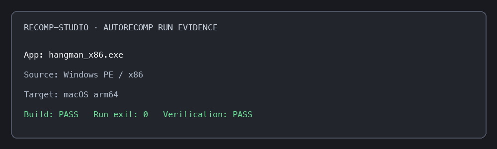
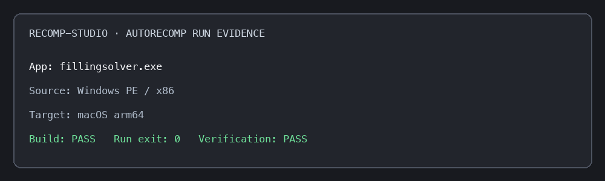

# Windows EXE to macOS native app run results

- Run date: 2026-10-28
- Host: macOS arm64 (`macos-arm64`)
- Runner: `build/recomp-studio autorecomp <EXE> --output "$TEMP/recomp-apps-audit/<name>" --buildrun`
- The status-card PNGs below summarize actual `autorecomp` logs. They are not screenshots of native app windows.
- `$TEMP` was set to macOS `TMPDIR` for these runs.

## Verified console apps

| App and source path | Source architecture | Target | Build/run and differential check | Manual input smoke | Evidence |
| --- | --- | --- | --- | --- | --- |
| `prime-gen_x86.exe` — `/Users/haseeb-mir/Downloads/recomp-apps/windows/cli-apps/1-prime-generator-c/build/prime-gen_x86.exe` | x86 Windows | macOS arm64 | Build passed; scripted stdin (`1`, `20`, `3`) completed with exit 0; differential output matched byte for byte (196 bytes); all 45 imports shimmed. | Script exercised menu selection, upper bound and exit. | `$TEMP/recomp-apps-audit/prime-gen-replay/autorecomp.log` |
| `hangman_x64.exe` — `/Users/haseeb-mir/Downloads/recomp-apps/windows/x64/games/hangman_x64.exe` | x64 Windows | macOS arm64 | Build passed; exit 0; differential output matched (292 bytes with stdin at EOF). One uncalled import remains: `api-ms-win-crt-private-l1-1-0.dll!__C_specific_handler`. | Native output responded to scripted guesses and exited 0. |  |
| `hangman_x86.exe` — `/Users/haseeb-mir/Downloads/recomp-apps/windows/x86/games/hangman_x86.exe` | x86 Windows | macOS arm64 | Build passed; exit 0; differential verification passed; no missing imports reported. | Native output responded to scripted guesses and exited 0. |  |

## Smoke-only and failed runs

| App and source path | Result | Evidence |
| --- | --- | --- |
| `fillingsolver.exe` — `/Users/haseeb-mir/Downloads/recomp-apps/win32/fillingsolver.exe` | Build and no-input run exited 0; differential check matched, but emitted no output and exercised only 333 instructions. Three imports are missing and uncalled (`getenv`, `_assert`, `__stdio_common_vsprintf`). This is not counted as a working app. |  |
| `cube.exe` — `/Users/haseeb-mir/Downloads/recomp-apps/win32/cube.exe` | Build succeeded; run and reference stopped at `comctl32.dll!InitCommonControls`. Coverage lifted 30,337/30,337 instructions, but 114/192 imports are missing. | No success screenshot; logs are under `$TEMP/recomp-apps-audit/cube_win32`. |

## Current count

- Distinct real corpus EXEs exercised in this pass: 5
- Console apps with scripted input and differential output verified: 1 (Prime Generator)
- Console apps with interactive native output observed: 2 (Hangman x64 and x86)
- No-output smoke only: 1 (Filling Solver)
- Failed to run: 1 (Cube)

`autorecomp --buildrun` now captures piped stdin once and replays it to the initial native run, the Unicorn reference and the differential candidate. Prime Generator verified this path using scripted input. GUI behavior has not been verified by these console checks.
